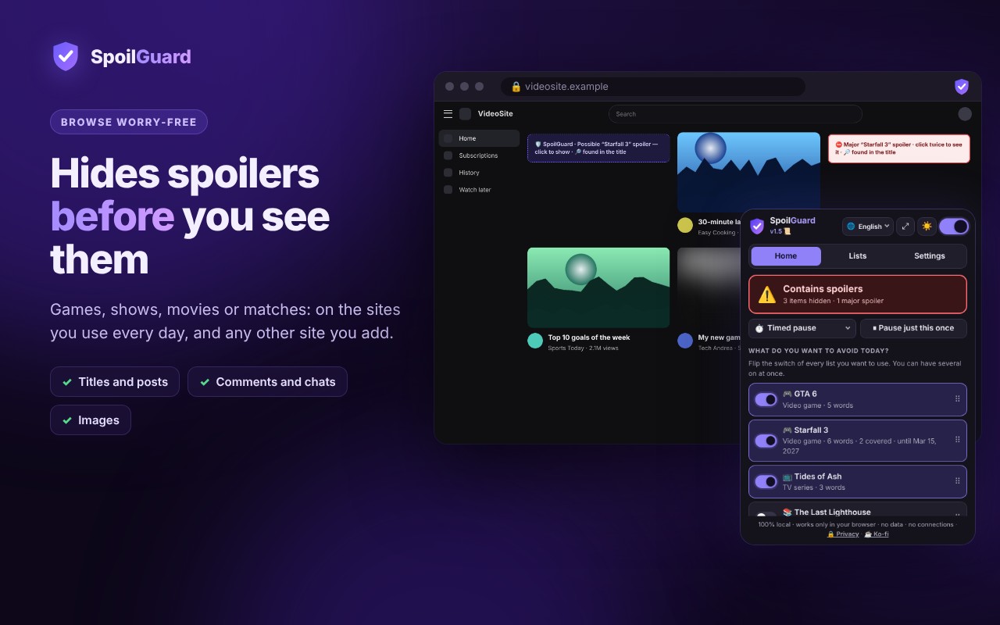
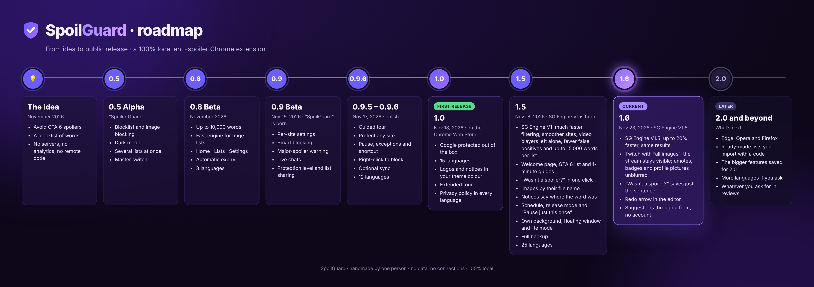

<h1 align="center">SpoilGuard</h1>

<b>Hides spoilers before you see them.</b> Free · 100% local · 25 languages

  <a href="https://chromewebstore.google.com/detail/spoilguard/lfhmbnhfdnjemigggephpakofbbfljba"><b>⬇️ Get it on the Chrome Web Store</b></a> ·
  <a href="https://bitolwin.github.io/SpoilGuard/">🔒 Privacy policy</a> ·
  <a href="CHANGELOG.md">📜 Release notes</a> ·
  <a href="CHANGELOG.es.md">📜 Notas en español</a>

> Install SpoilGuard from the Chrome Web Store link above: that's the official version, and it updates itself.

SpoilGuard hides spoilers before you see them.

Make a list of words for what you want to avoid (a game, a show, a film, a match) and SpoilGuard covers the posts, videos, comments, search results and chat messages that mention them.

## Everything it does

- Works on the big sites you use every day (search, video, streams and social networks), plus any site you add
- Smart blocking: catches “Starfall III”, “S t a r f a l l 3” or “#Starfall3Leaks” even if you only typed “Starfall 3”
- Major-spoiler warning for endings, deaths and leaks
- Exceptions to let harmless news through
- Click to reveal, quick pause, keyboard shortcut and a style for each site
- Right-click to block any text (you can turn it off)
- Your colour everywhere: theme, logos and notices
- Share lists with a code, optional sync through your browser’s own sync
- 25 languages

## New in 1.6

- SG Engine V1.5: up to 20% faster, with the same results
- Twitch with “all images”: the stream you open stays visible, and emotes (7TV, BTTV and FFZ too), badges and profile pictures are no longer blurred
- “Wasn’t a spoiler?” saves just the comment’s sentence, plus a new redo arrow in the editor
- “Send a suggestion” opens a simple form, no account needed

## What came with 1.5

- Get started in seconds: a welcome page, a ready-made GTA 6 list and 1-minute guides
- New, much faster engine: up to 15,000 words per list and smoother sites
- “Wasn’t a spoiler?”: add an exception in one click
- Also catches the word in image file names (optional)
- Notices can tell you where the word was: title, comment, chat, image…
- Protection schedule, release mode and “Pause just this once”
- Protection level with ranks, a floating window and lite mode for modest computers
- Your own background image, a colour picker and full backup

Privacy: 100% local. SpoilGuard has no server, collects no data, shows no ads and makes no connections. It is free.

## Roadmap

_Roadmap en español: [spoilguard-roadmap-es.png](spoilguard-roadmap-es.png)_

## Ideas or bugs?

SpoilGuard is made by one person. Tell me through this [short form](https://forms.gle/xEjEArWHRfoKM7iM7) (no account needed, any language) or with the **Send a suggestion** button inside SpoilGuard: I read every message.
